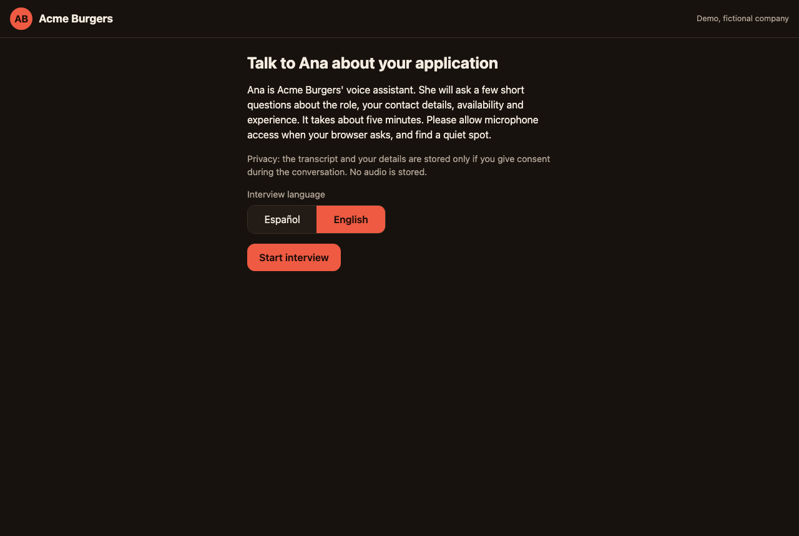
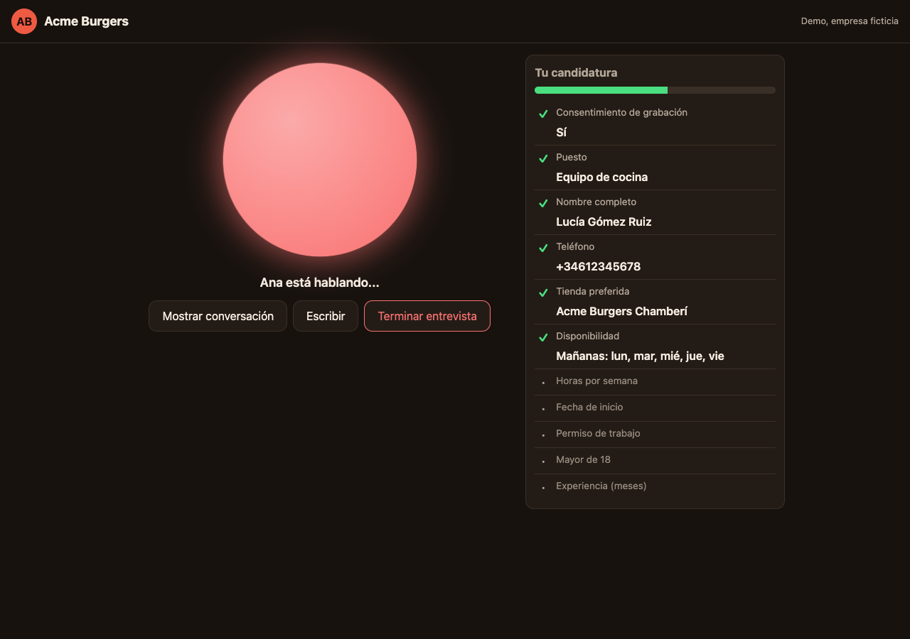
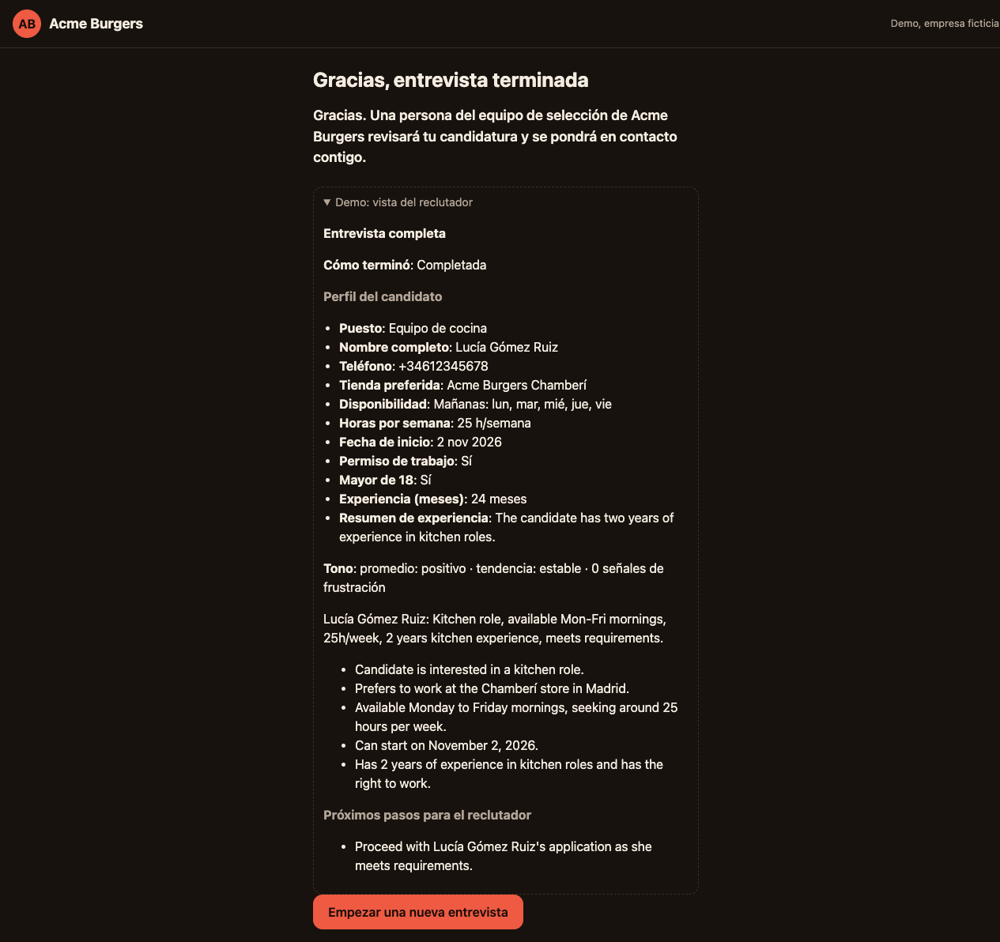
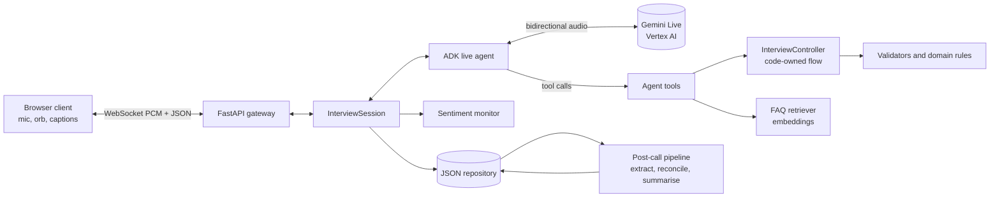

# Acme Agent

**Ana**, a bilingual (Spanish / English) voice screening agent for frontline hiring at a
fictional fast-food chain, **Acme Burgers** (Spain and Mexico). This is a personal proof of
concept: everything about the company, its stores, pay and policies is invented.

There is no phone line: the candidate opens a web page, clicks *Start*, and talks. She asks for
consent first, then collects the profile (role, name, phone, availability, hours, start date,
store, right to work, and role-specific items such as a licence for riders), answers questions
about the job from a small FAQ, reads everything back for confirmation, and says goodbye. After
the call the transcript is re-processed, reconciled with what was captured live, and summarised
for a human recruiter, who makes the actual decision.



| Live conversation | Post-call summary |
|---|---|
|  |  |

Demo video: _coming soon_ · Demo script: [docs/DEMO.md](docs/DEMO.md)

A typical call (Spanish, abridged):

> **Ana:** Hola, soy Ana de Acme Burgers. Antes de empezar, ¿me das tu consentimiento para guardar tus respuestas?
> **Candidate:** Sí, claro.
> **Ana:** Genial. ¿A qué puesto te gustaría presentarte?
> **Candidate:** Repartidor. Me llamo Lucía Gómez y mi teléfono es 612 345 678.
> **Candidate:** ¿Cuánto se cobra? — **Ana:** (answers from the FAQ, then returns to the pending question)

## Features

Implemented:

- Real-time voice with Gemini Live native audio on Vertex AI: server-side voice activity
  detection, barge-in (interrupting Ana stops her), live captions in both directions.
- Structured extraction with validation: the model normalises meaning, code validates
  (phones, dates, hours, stores, yes/no) and rejects or re-asks ([ADR-015](anton/architecture/decisions/ADR-015-model-normalised-slots.md)).
- Code-owned interview flow: the controller decides which question comes next; the model never
  skips or invents steps ([ADR-016](anton/architecture/decisions/ADR-016-code-owned-flow-v2.md)).
- Consent first, confirmation when consent is declined, and a `purge` command for retention.
- Read-back of the whole profile with corrections accepted ("no, mejor el día 3").
- Post-call pipeline: second extraction from the transcript, reconciliation with live data,
  structured summary, deterministic screening status, human-review flags.
- JSON storage behind a repository interface (atomic writes).
- FAQ answers through retrieval over embeddings (RAG), then return to the pending question.
- Sentiment monitor, frustration offer, and escalation to a human recruiter.
- Spanish and English: language selector at the start and a mid-call switch.
- Text mode (`make chat`) sharing the same core as voice.
- Browser client with an animated orb, live profile panel, captions, summary and a collapsed
  "Demo: recruiter view".
- `acme-agent stats` over stored conversations.

Not implemented (specified, not built):

- Bilingual hardening (SPEC-013).
- Persona-based evaluations (SPEC-014): `make eval` is a placeholder that only prints a message.
- Returning candidate continues an unfinished interview (SPEC-015).
- Cloud Run deployment and GCS storage (SPEC-016): the `gcs` storage setting exists in
  `.env.example` but is not wired up.

## Quick start

Prerequisites: Python 3.13, [uv](https://docs.astral.sh/uv/), the `gcloud` CLI, and a Google
Cloud project with billing and the Vertex AI API enabled. There are no API keys: authentication
uses Application Default Credentials only.

```bash
uv sync
gcloud auth application-default login
gcloud auth application-default set-quota-project <your-project-id>
cp .env.example .env          # set GOOGLE_CLOUD_PROJECT and GOOGLE_CLOUD_LOCATION
make test                     # offline, no cloud calls
make chat                     # text-mode interview in the terminal (real model)
make serve                    # web client at http://localhost:8000
```

Open http://localhost:8000 in Chrome, pick a language, allow the microphone, and click *Start*.

Troubleshooting:

- `RefreshError` / credentials errors: run `gcloud auth application-default login` again.
- The page looks old or buttons do nothing after an update: hard reload (Cmd/Ctrl+Shift+R).
- Ana interrupts herself or hears echo: use headphones.
- Browser blocked by origin: add your URL to `ACME_ALLOWED_ORIGINS` (a JSON list) and restart.

CLI:

```text
acme-agent version | list | show <id> | stats | purge | chat | serve
```

## Architecture



| Package (`src/acme_agent/`) | Role |
|---|---|
| `web/` | FastAPI app, WebSocket protocol, `InterviewSession`, static browser client |
| `agent/` | ADK live agent, text agent, tool definitions |
| `interview/` | Controller, slot specs, prompts, read-back, closing, events |
| `domain/` | Models, screening rules, spoken-input parsing, slot validators |
| `knowledge/` | FAQ chunking, embedder, retriever |
| `analysis/` | Post-call extraction, reconciliation, summary, sentiment |
| `storage/` | Repository interface and atomic JSON implementation |
| `cli.py`, `bootstrap.py`, `config.py`, `logging.py` | CLI, wiring, settings, structured logs |

More detail: [docs/DESIGN.md](docs/DESIGN.md) (product and design),
[docs/TECHNICAL_DESIGN.md](docs/TECHNICAL_DESIGN.md) (implementation),
[architecture decisions](anton/architecture/decisions/) (ADR-001 to ADR-016; ADR-004 and
ADR-005 are superseded by ADR-016 and ADR-015).

## Key design decisions

| Decision | Why | ADR |
|---|---|---|
| Gemini Live native audio on Vertex AI | One low-latency speech-to-speech model with VAD and barge-in | [002](anton/architecture/decisions/ADR-002-voice-gemini-live.md) |
| Google ADK plus a FastAPI WebSocket gateway | Live-streaming agent runtime; browser speaks plain WebSocket | [003](anton/architecture/decisions/ADR-003-framework-adk.md) |
| Code owns the flow; the LLM talks and extracts via tools | Deterministic order, no skipped steps, testable without a model | [016](anton/architecture/decisions/ADR-016-code-owned-flow-v2.md) |
| Model normalises meaning, code validates | Handles spoken variety ("el tres de mayo") while keeping hard guarantees | [015](anton/architecture/decisions/ADR-015-model-normalised-slots.md) |
| JSON files behind a repository interface | Zero infrastructure now, swappable for a bucket or database | [006](anton/architecture/decisions/ADR-006-storage.md) |
| Small FAQ with embedding retrieval | Grounded answers, "I don't know" when nothing matches | [007](anton/architecture/decisions/ADR-007-rag.md) |
| Post-call extraction and reconciliation | Live capture can miss or mishear; the transcript is the second opinion | [008](anton/architecture/decisions/ADR-008-post-call-processing.md) |
| Human in the loop, deterministic screening status | The agent never rejects anyone; rules are code, not model opinion | [009](anton/architecture/decisions/ADR-009-human-in-the-loop.md) |
| Text mode on the same core | Fast tests and development without audio | [010](anton/architecture/decisions/ADR-010-text-mode-and-testing.md) |
| Background sentiment and escalation | Offer a recruiter when the candidate is frustrated | [011](anton/architecture/decisions/ADR-011-sentiment.md) |
| Spanish and English with mid-call switching | The two markets served by the chain | [012](anton/architecture/decisions/ADR-012-languages.md) |
| ADC only, ruff, mypy, pytest | No secrets in the repo; strict, quick feedback | [014](anton/architecture/decisions/ADR-014-tooling.md) |

## Data and privacy

Each conversation is one JSON file under `data/conversations/`. A record holds: metadata
(id, timestamps, end reason, channel, language, model), the `candidate` profile, per-field
metadata (source, raw words, attempts, corrections, status), the `screening` result and review reasons,
`sentiment`, the structured `summary`, the full `transcript`, and an `events` log. See
[tests/fixtures/record_example.json](tests/fixtures/record_example.json).

- Consent is asked before anything else. If declined, only metadata and the consent answer are
  stored.
- Names and phone numbers are masked in logs (for example `+34******456`); full values live only
  in the record.
- `acme-agent purge --yes` deletes records older than `ACME_RETENTION_DAYS` (default 30);
  without `--yes` it is a dry run.
- Audio is not stored. Protected characteristics are never asked; eligibility is only
  "right to work" and "18 or over", never an exact age.
- The screening status is a recommendation for a person; the candidate-facing summary is
  neutral and shows no outcome.

## Testing

```bash
make test        # ~1090 tests, offline (cloud tests are deselected by default)
make lint        # ruff check and format check
make typecheck   # mypy
make cov         # coverage gate (>= 90%) on domain and interview
uv run pytest -m live tests/unit/test_retriever.py   # FAQ retrieval accuracy (needs GCP)
uv run pytest -m live tests/unit/test_post_call.py   # post-call extraction on a fixture transcript
uv run pytest -m live tests/integration/test_text_mode.py   # scripted text interviews, real model
uv run pytest -m live tests/web/test_live_audio.py   # a real Gemini Live audio round trip
```

Offline tests cover the domain rules, validators, controller, storage, tools, gateway protocol,
post-call logic and the browser client's formatting with fakes. Live tests call Vertex AI.
A manual browser checklist is in [docs/QA_BROWSER.md](docs/QA_BROWSER.md).

## Measured numbers

From live runs during development (single machine, home connection):

| Metric | Result |
|---|---|
| Model response (final transcription to first agent audio), median | about 1.0 s (1.0 to 1.3 s) |
| Perceived response (end of candidate speech to first agent audio), median | about 2.0 s (1.96 to 2.3 s) |
| FAQ retrieval top-1 accuracy (20 labelled questions) | 0.95; off-topic correctly rejected 5/5 |
| Query embedding latency | about 250 ms |
| Greeting first audio | 3 to 4 s warm, about 11 s on a cold start |

## Project layout

```text
.
├── README.md
├── Makefile                  # setup, test, lint, typecheck, cov, serve, chat
├── pyproject.toml            # dependencies and tool config (uv)
├── .env.example              # configuration template
├── docs/                     # DESIGN, TECHNICAL_DESIGN, QA_BROWSER, DEMO, images
├── knowledge/                # fictional FAQ (es/en) and store list
├── src/acme_agent/           # agent, analysis, domain, interview, knowledge, storage, web
├── tests/                    # unit, integration, web, conversation, fixtures
├── scripts/ws_client.py      # command-line WebSocket client for manual runs
├── data/                     # stored conversations (git-ignored content)
└── anton/                    # constitution, architecture, ADRs and per-feature specs
```

The `anton/` folder is a spec-driven workflow: each feature has a spec with acceptance criteria,
tasks and an implementation log, and decisions are recorded as ADRs before code is written.

## Limitations and potential improvements

- Perceived latency is about 2.0 s against a 1.5 s target. Next levers: acknowledge-first
  replies, non-blocking tool calls, and a warm session for the greeting.
- Sessions do not survive a dropped connection; add reconnect with session resumption.
- The recruiter view is a demo panel inside the candidate page; a real recruiter dashboard
  (queue by status, transcript playback) would replace it.
- Storage is local JSON; move to a bucket and deploy on Cloud Run (SPEC-016).
- No automated persona evaluations yet (SPEC-014) and bilingual edge cases are only lightly
  hardened (SPEC-013).
- Returning candidates start from scratch (SPEC-015).
- Telephony and WhatsApp channels, calendar scheduling, ATS integration, tenant configuration,
  a larger managed RAG store, and optional audio retention (with consent) are out of scope for
  this PoC.
