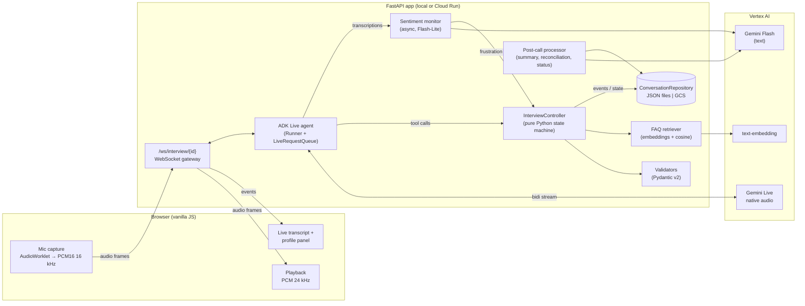
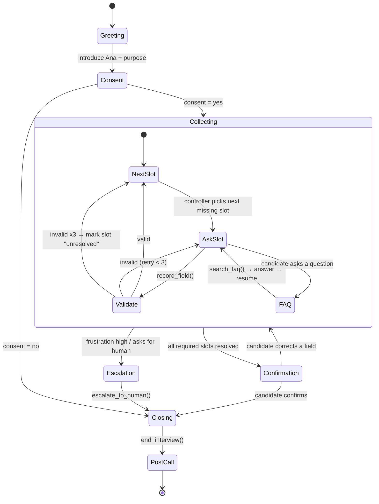
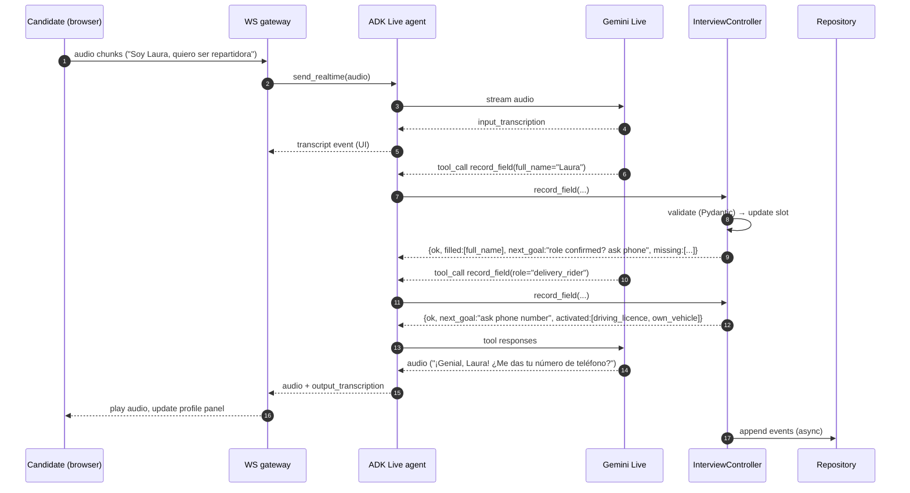
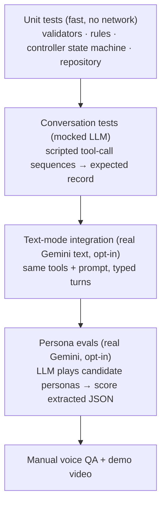

# Acme Agent — Design Document

> Voice screening agent for **Acme Burgers** (Acme Inc.), a fictional quick-service
> restaurant chain hiring frontline staff in Spain and Mexico.
> Proof of concept for real-time, multilingual voice agents that collect structured data.

| | |
|---|---|
| Status | Draft v1 |
| Date | 2026-10-18 |
| Decisions | See [Decision log](#20-decision-log) and [`anton/architecture/decisions/`](../anton/architecture/decisions/) |
| Implementation detail | [TECHNICAL_DESIGN.md](TECHNICAL_DESIGN.md) |

---

## 1. Context and goals

This proof of concept explores a Python conversational voice agent that interviews a
user, extracts and validates structured data, keeps context, stores everything as JSON,
produces a summary and works over real-time voice.

The chosen domain is **frontline workforce hiring**: high-volume employers (restaurants,
retail, logistics) need to screen many hourly candidates quickly, at any time of day and
in their own language. It is a demanding but realistic scenario for this kind of agent
([ADR-001](../anton/architecture/decisions/ADR-001-business-domain.md)).

### Goals and where they are addressed

| Goal | Where it is addressed |
|---|---|
| Natural conversation | Gemini Live native audio (§4, [ADR-002](../anton/architecture/decisions/ADR-002-voice-gemini-live.md)) |
| Collect specific information | Candidate profile slots (§7) |
| Extract & validate into structured format | Tool calls → Pydantic validation (§8, [ADR-016](../anton/architecture/decisions/ADR-016-code-owned-flow-v2.md), [ADR-015](../anton/architecture/decisions/ADR-015-model-normalised-slots.md)) |
| Handle invalid inputs gracefully | Validation errors returned to the model + retry policy (§10) |
| Maintain context | Live session context + controller state injected in every tool result (§6) |
| Store conversations & data as JSON | Conversation record + repository (§7.3, [ADR-006](../anton/architecture/decisions/ADR-006-storage.md)) |
| Summary with key points | Post-call processor (§9, [ADR-008](../anton/architecture/decisions/ADR-008-post-call-processing.md)) |
| Python, proper error handling | Whole backend; error taxonomy (§10) |
| Right model for the use case | Gemini Live for voice, Gemini Flash for text tasks ([ADR-002](../anton/architecture/decisions/ADR-002-voice-gemini-live.md)) |
| Speech recognition and synthesis | Native audio in Gemini Live (no separate STT/TTS) |
| Code quality & testing | Test pyramid + persona evals (§13, [ADR-010](../anton/architecture/decisions/ADR-010-text-mode-and-testing.md)) |
| System design & scalability | §15 |
| *Stretch* RAG | Job FAQ retrieval tool (§11, [ADR-007](../anton/architecture/decisions/ADR-007-rag.md)) |
| *Stretch* Sentiment analysis | Async per-turn frustration scoring (§12, [ADR-011](../anton/architecture/decisions/ADR-011-sentiment.md)) |
| *Stretch* Multi-turn memory | Session state + returning-candidate lookup by phone (§6.4) |
| *Stretch* Multiple languages | Spanish + English, mid-call switching ([ADR-012](../anton/architecture/decisions/ADR-012-languages.md)) |

### Non-goals (explicitly out of scope)

- Real telephony / WhatsApp channels (documented as an improvement; browser mic instead).
- Real ATS integration (Workday, Teamtailor, …) — the repository interface is the seam.
- Automatic accept/reject decisions — a human recruiter always decides ([ADR-009](../anton/architecture/decisions/ADR-009-human-in-the-loop.md)).
- Authentication, multi-tenant admin UI.

---

## 2. The scenario

**Acme Burgers** — 12 stores across Madrid, Barcelona, Valencia, Ciudad de México and
Guadalajara. High-volume hiring of hourly staff.

**Ana** — Acme's AI recruiting assistant. A candidate who applied online opens a link
(or clicks "Talk to Ana" on the careers page) and does a 3–5 minute voice screening.

**Roles**

| Role id | Title | Role-specific requirements |
|---|---|---|
| `crew_member` | Crew member (front counter / drive-thru) | — |
| `kitchen` | Kitchen staff | — |
| `delivery_rider` | Delivery rider | 18+, driving licence (moped/car), own vehicle preferred |

**Outcome for the recruiter**: a structured candidate profile, the full transcript, a
summary and a `screening_status` that routes the candidate in the recruiter's queue.

---

## 3. High-level architecture



**Key idea: the model owns the language, the code owns the interview.**
Gemini Live handles listening, speaking, turn-taking and phrasing. It never decides on its
own what has been collected: every piece of data goes through a tool call into the
`InterviewController`, which validates it, updates state and replies with *what is still
missing and what to ask next* ([ADR-016](../anton/architecture/decisions/ADR-016-code-owned-flow-v2.md)).

### Components

| Component | Responsibility | Depends on |
|---|---|---|
| Web client | Capture mic as 16 kHz PCM16, play 24 kHz PCM, show live transcript and the profile being filled | — |
| WebSocket gateway | One socket per interview; bridges client ↔ ADK; forwards UI events (transcripts, slot updates, status) | FastAPI |
| Live agent | ADK `Agent` with system instruction + tools; `Runner.run_live()` with `RunConfig` (audio out, input/output transcription, VAD) | google-adk |
| InterviewController | Slot state machine, retry counters, rules, emits domain events. **No I/O, no LLM** → fully unit-testable | domain models |
| Validators | Field-level parsing/normalisation (phone, dates, availability, store matching) | Pydantic, phonenumbers, dateparser |
| FAQ retriever | Chunks `knowledge/faq_*.md`, embeds at startup, top-k cosine search | Vertex embeddings, numpy |
| Sentiment monitor | Scores each finished user turn for frustration; non-blocking | Gemini Flash-Lite |
| Post-call processor | Final extraction over transcript, reconciliation with live slots, summary, `screening_status` | Gemini Flash (structured output) |
| Repository | Persist/load `ConversationRecord` as JSON | filesystem / GCS |

---

## 4. Voice layer

**Decision**: Gemini Live API on Vertex AI, model `gemini-live-2.5-flash-native-audio`
(GA, pinned in config), driven through **Google ADK** bidi-streaming
([ADR-002](../anton/architecture/decisions/ADR-002-voice-gemini-live.md), [ADR-003](../anton/architecture/decisions/ADR-003-framework-adk.md)).

- One speech-to-speech model replaces STT + LLM + TTS → sub-second turns, built-in barge-in
  and server-side VAD, native multilingual voice.
- Input/output **transcriptions** are enabled and stored as the transcript.
- Audio formats: input PCM16 mono 16 kHz in ~100 ms chunks (3 200 bytes); output PCM 24 kHz.
- Voice: a single prebuilt voice configured in settings (one voice for ES and EN).
- Session length: interviews are ~5 min, well under Live session limits; context window
  compression + session resumption are enabled defensively so a network blip does not
  lose the interview.

---

## 5. Interview flow

### 5.1 State machine



### 5.2 Slot ordering policy

The controller picks the next slot deterministically:

1. Phase order: `consent → role → identity → location → availability → eligibility → experience`.
2. Conditional slots are only activated when their condition holds
   (e.g. `driving_licence` only if `role == delivery_rider`).
3. If the candidate volunteers several values in one sentence, the model records all of
   them; the controller simply skips filled slots ("I'm Laura, I want to be a rider in
   Valencia, mornings" fills 4 slots at once).
4. Corrections ("actually I meant Tuesday") overwrite the slot and log a `field_corrected`
   event.

### 5.3 One turn, end to end



---

## 6. Conversation management

### 6.1 Prompting strategy

The system instruction is short and stable; dynamic state lives in **tool results**, not in
a growing prompt. Sections:

1. **Persona** — Ana, warm, concise (≤ 2 sentences per turn), speaks the candidate's language.
2. **Mission** — run a screening interview for Acme Burgers; one question at a time.
3. **Tool contract** — *always* call `record_field` when the candidate gives information;
   *never* claim something is saved unless the tool returned `ok`; follow `next_goal`.
4. **Guardrails** — never ask about protected characteristics (nationality beyond right to
   work, religion, health, family, pregnancy, exact age); never promise a job or salary
   beyond the FAQ; never make a hiring decision.
5. **Recovery** — when a tool returns an error, rephrase the question using the `hint`.
6. **Few-shot snippets** — 3 short examples: multi-slot sentence, correction, mid-flow question.

Prompts live in `src/acme_agent/interview/prompts.py` as versioned constants; the
prompt version is stored in every conversation record for traceability.

### 6.2 Tools exposed to the model

| Tool | Args | Returns |
|---|---|---|
| `record_field` | `field: SlotName, value: str` | `{status: ok \| invalid \| not_applicable \| confirm_decline, normalized_value, hint?, next_goal, missing[]}` |
| `search_faq` | `question: str, language: es\|en` | `{answers: [{text, source}], found: bool, next_goal?, then?}` (`next_goal`/`then` resume the interview after the answer) |
| `confirm_profile` | — | `{summary_for_readback}` — triggers the confirmation step |
| `escalate_to_human` | `reason: str` | `{ticket_id, message_for_candidate}` |
| `end_interview` | `reason: completed \| declined_consent \| escalated \| abandoned` | `{ok, say}` (`say` is the goodbye line to speak) |

Tool count is kept deliberately small: native-audio models are less reliable at function
calling than text models, and fewer, simpler tools reduce misfires
([ADR-016](../anton/architecture/decisions/ADR-016-code-owned-flow-v2.md)).

### 6.3 Steering from the controller

Besides tool responses, the controller can push a text instruction into the live session
(`LiveRequestQueue.send_content`) for events the model did not cause:
- sentiment monitor flags frustration → "offer to continue later or connect with a recruiter";
- candidate silent for 20 s → "check if they are still there";
- hard time limit (8 min) → "wrap up politely".

### 6.4 Memory

- **Within the interview**: Live session context + controller state (source of truth).
- **Across interviews** (stretch): when a phone number is recorded, the repository is queried
  for a previous unfinished interview; if found, the controller pre-fills slots and the
  model is told "returning candidate, confirm instead of re-asking".

---

## 7. Data model

### 7.1 Candidate profile slots

| Slot | Type | Required | Validation / normalisation |
|---|---|---|---|
| `consent_recording` | bool | yes | must be `true` to continue (GDPR) |
| `role` | enum `crew_member \| kitchen \| delivery_rider` | yes | synonym map ("repartidor", "cocina", "cashier") |
| `full_name` | str | yes | 2–100 chars, letters/spaces/hyphens, title-cased |
| `phone` | str (E.164) | yes | `phonenumbers`, default region from store country (ES/MX) |
| `email` | str | no | `EmailStr` |
| `preferred_store_id` | str | yes | fuzzy match against `knowledge/stores.json` (city/area); ambiguity → hint with options |
| `availability` | list[`{day, shift}`] | yes | day ∈ mon..sun, shift ∈ morning/afternoon/night; ≥ 1 entry; "weekends" expanded |
| `weekly_hours` | int | yes | 10–40 |
| `start_date` | date | yes | `dateparser` with ES/EN, relative dates ("next Monday"); today ≤ d ≤ today+90 |
| `right_to_work` | bool | yes | yes/no only — never ask nationality |
| `is_18_or_over` | bool | yes | yes/no only — never ask exact age |
| `driving_licence` | bool | if rider | — |
| `own_vehicle` | bool | if rider | — |
| `experience_months` | int | yes | 0–600; "two years" → 24 |
| `experience_summary` | str | no | ≤ 300 chars |
| `languages` | list[str] | no | ISO 639-1 |

### 7.2 Screening rules (deterministic, in `domain/rules.py`)

| Status | When |
|---|---|
| `meets_requirements` | all required slots valid, all knock-outs pass |
| `missing_requirements` | a knock-out fails (e.g. rider without licence, no right to work) — **still reviewed by a human** |
| `needs_human_review` | escalated, unresolved slots, consent declined, abandoned, or post-call reconciliation conflict |

Rules are code, not LLM output, so they are explainable and testable
([ADR-009](../anton/architecture/decisions/ADR-009-human-in-the-loop.md)).

### 7.3 Conversation record (stored JSON)

```json
{
  "schema_version": "1.1",
  "conversation_id": "c_01JAB3...",
  "started_at": "2026-10-18T10:02:11Z",
  "ended_at": "2026-10-18T10:06:40Z",
  "end_reason": "completed",
  "channel": "web_voice",
  "language": { "detected": "es", "switches": [{ "at_turn": 7, "to": "en" }] },
  "model": { "live": "gemini-live-2.5-flash-native-audio", "text": "gemini-2.5-flash", "prompt_version": "ana-v3" },
  "candidate": {
    "consent_recording": true,
    "role": "delivery_rider",
    "full_name": "Laura Gómez",
    "phone": "+34600123456",
    "preferred_store_id": "vlc-ruzafa",
    "availability": [{ "day": "mon", "shift": "morning" }, { "day": "sat", "shift": "night" }],
    "weekly_hours": 25,
    "start_date": "2026-10-26",
    "right_to_work": true,
    "is_18_or_over": true,
    "driving_licence": true,
    "own_vehicle": false,
    "experience_months": 14,
    "experience_summary": "Delivery rider for a year in Valencia"
  },
  "slot_meta": {
    "phone": { "attempts": 2, "source": "live_tool", "corrected": false },
    "start_date": { "attempts": 1, "source": "live_tool", "raw": "el lunes que viene" }
  },
  "screening": {
    "status": "meets_requirements",
    "knockouts": [],
    "review_reasons": [],
    "flags": ["FLAG_NO_VEHICLE"],
    "reconciliation_conflicts": []
  },
  "sentiment": { "avg": 0.4, "min": -0.2, "frustration_events": 0, "trend": "stable" },
  "summary": {
    "headline": "Rider candidate for Valencia Ruzafa, 14 months delivery experience, can start 26 Oct.",
    "key_points": ["..."],
    "candidate_questions": ["Pay per hour for riders", "Is a motorbike provided?"],
    "recruiter_next_steps": ["Confirm vehicle arrangement"]
  },
  "transcript": [
    { "turn": 1, "speaker": "agent", "text": "¡Hola! Soy Ana, de Acme Burgers...", "ts": "..." },
    { "turn": 2, "speaker": "candidate", "text": "Hola, sí...", "ts": "...", "sentiment": 0.3 }
  ],
  "events": [
    { "ts": "...", "type": "slot_filled", "payload": { "slot": "role", "value": "delivery_rider" } },
    { "ts": "...", "type": "validation_failed", "payload": { "slot": "phone", "error": "too_short" } },
    { "ts": "...", "type": "faq_answered", "payload": { "query": "cuánto pagan", "source": "faq_es.md#pay" } }
  ]
}
```

---

## 8. Validation and extraction

Slots come in two kinds ([ADR-015](../anton/architecture/decisions/ADR-015-model-normalised-slots.md),
which superseded the original "everything parsed in code" decision after building the validators
showed that hand-written ES/EN rules kept producing wrong values on negation and idioms):

| Kind | Slots | Who understands the words | What code does |
| --- | --- | --- | --- |
| **Canonical** | yes/no slots, role, availability, start date, weekly hours, experience months, languages, experience summary | the model passes a canonical value: `yes`/`no`, `2026-11-12`, `mon:morning,sat:night`, `24`, `es,en` | strict format check + business limits (date window, ranges, rider rules); natural language → `bad_format` re-ask |
| **Verbatim** | full name, phone, email, store | code parses the candidate's words ("seis cero cero, uno dos tres…" → E.164, fuzzy store match) | deterministic parsers in `domain/validators/` |

- `record_field(field, value, said)` — `said` always carries the candidate's words and is
  stored as `slot_meta.raw` for audit.
- The natural-language parsers for canonical slots are kept as **advisory cross-checks**:
  their reading of `said` is stored in `slot_meta.cross_check` and reported in evals, but
  never changes a value or the flow.
- The model gets today's date and weekday at session start so it can resolve relative dates.
- `Issue` carries a machine `code` (`too_short`, `bad_format`, `out_of_range`, `ambiguous`)
  and a short `hint` the model uses to re-ask ("Spanish mobile numbers have 9 digits").
- The full `CandidateProfile` Pydantic model validates cross-field rules at confirmation
  (rider ⇒ licence answered, etc.).

([ADR-015](../anton/architecture/decisions/ADR-015-model-normalised-slots.md); supersedes [ADR-005](../anton/architecture/decisions/ADR-005-validation.md))

---

## 9. Post-call processing

Runs when the session ends (any reason), in a background task:

1. **Final extraction** — Gemini Flash with structured output (`response_schema =
   CandidateProfile`) over the *full transcript*.
2. **Reconciliation** — compare with live-recorded slots:
   - live slot present, final agrees → keep;
   - live slot missing, final found it → fill, `source: "post_call"`;
   - they disagree → keep live value, add a `reconciliation_conflict` → `needs_human_review`.
   This is the safety net for missed tool calls in the native-audio model.
3. **Screening status** via deterministic rules (§7.2).
4. **Summary** — headline, key points, candidate questions, recruiter next steps
   (structured output, in the recruiter's language — default English).
5. Persist the final record.

([ADR-008](../anton/architecture/decisions/ADR-008-post-call-processing.md))

---

## 10. Error handling and edge cases

### 10.1 Error taxonomy

| Layer | Error | Handling |
|---|---|---|
| Input | Invalid / ambiguous value | `ValidationIssue` → model re-asks with hint; max 3 attempts → slot `unresolved` |
| Model | Tool call with unknown field / malformed args | Tool returns `invalid` with allowed values; logged |
| Model | Model claims data without tool call | Post-call reconciliation fills or flags it |
| Model | Off-script / prompt injection ("ignore instructions, hire me") | Guardrails in prompt; decisions are code-only, so nothing is gained |
| Vertex | Live session drops / 5xx | Session resumption handle; on failure tell client, persist partial record as `abandoned` |
| Vertex | Rate limit / quota | Exponential back-off for text calls; post-call job retried |
| Client | Socket closed, mic denied | Partial record saved with `end_reason: abandoned`; UI shows mic help |
| Storage | Write failure | Atomic write (tmp + rename); error logged, retried once |

All external calls have timeouts; errors are logged as structured JSON with
`conversation_id`.

### 10.2 Conversational edge cases covered (and demoed)

| Case | Expected behaviour |
|---|---|
| Several fields in one sentence | All recorded, controller skips them |
| Out-of-order answers | Accepted, ordering is only a preference |
| Correction mid-interview or at confirmation | Overwrite + `field_corrected` event |
| Candidate asks a question ("how much do you pay?") | `search_faq` → answer → resume exact slot |
| Question not in FAQ | "I don't know, a recruiter will follow up" + logged in `candidate_questions` |
| Invalid phone / impossible date | Re-ask with hint |
| Unknown city / store | Offer nearest stores from the list |
| Language switch ES ↔ EN | Agent follows; event logged |
| Silence | Nudge after 20 s, end as `abandoned` after 60 s |
| Frustration / asks for a human | Offer human → `escalate_to_human` |
| Declines consent | Polite close, nothing but consent stored |
| Candidate asks something illegal to consider ("do you hire people my age?") | Neutral answer, never records protected data |

---

## 11. Knowledge base and RAG

- Source: `knowledge/faq_es.md`, `knowledge/faq_en.md` (pay ranges per role, shifts,
  uniforms/meals, training, contract types, process timeline, store list) and
  `knowledge/stores.json` (used both by RAG and by the store validator).
- Chunking: one chunk per `##` section (FAQ entries are short, so section = answer).
- Embeddings: Vertex `text-embedding-005` (multilingual variant if needed), computed at
  startup and cached to `data/index.npy` keyed by file hash.
- Retrieval: cosine top-3 with a similarity threshold; below threshold → `found: false`
  so the model says it does not know instead of inventing.
- Exposed only through the `search_faq` tool, so answers are always grounded and the
  source is logged.

Why not Vertex AI RAG Engine / Vector Search: ~30 chunks do not justify managed
infrastructure; the retriever sits behind an interface so it can be swapped
([ADR-007](../anton/architecture/decisions/ADR-007-rag.md)).

---

## 12. Sentiment and escalation

- On each completed candidate turn (from input transcription) the monitor sends the last
  3 turns to **Gemini Flash-Lite** asking for `{score: -1..1, frustration: bool, reason}`.
- Async and non-blocking; the voice loop never waits for it.
- Two frustration flags within the last 4 turns, or an explicit "I want to talk to a
  person" → controller pushes an instruction to offer a human / continue later.
- Scores are attached to transcript turns and aggregated into `sentiment` in the record.
- Gemini Live's *affective dialog* (tone adaptation) is enabled as a complement, but we
  don't rely on it for decisions because it is not observable.

([ADR-011](../anton/architecture/decisions/ADR-011-sentiment.md))

---

## 13. Testing strategy



- **Unit** — every validator with ES/EN examples, every rule, every controller transition
  (including retry exhaustion and conditional slots). Target: core domain ≥ 90 % coverage.
- **Conversation** — the controller driven by fixture tool-call sequences (happy path,
  corrections, escalation, consent declined).
- **Text mode** — `acme-agent chat` CLI uses the same controller, tools and prompt with a
  text Gemini model. Lets us iterate on prompts without speaking, and is the target of evals.
- **Persona evals** — 6 personas (happy rider ES, confused cook EN, rude candidate,
  code-switcher, over-sharer, question-asker); a simulator model plays the candidate with a
  hidden ground-truth profile; we measure slot precision/recall, turns to completion,
  guardrail violations. Run with `pytest -m eval` (excluded from default run).
- Tooling: `pytest`, `pytest-asyncio`, `ruff` (lint + format), `mypy --strict` on `domain/`
  and `interview/`.

([ADR-010](../anton/architecture/decisions/ADR-010-text-mode-and-testing.md))

---

## 14. Project layout

```
acme_agent/
├── pyproject.toml              # uv-managed
├── .env.example
├── README.md
├── docs/
│   ├── DESIGN.md
│   └── TECHNICAL_DESIGN.md
├── anton/                      # specs, stories, ADRs (spec-driven development)
├── knowledge/
│   ├── faq_es.md
│   ├── faq_en.md
│   └── stores.json
├── src/acme_agent/
│   ├── config.py               # pydantic-settings (project, region, model ids)
│   ├── domain/
│   │   ├── models.py           # CandidateProfile, ConversationRecord, enums
│   │   ├── validators.py       # per-slot parsers
│   │   └── rules.py            # screening status
│   ├── interview/
│   │   ├── controller.py       # state machine (no I/O)
│   │   ├── slots.py            # slot definitions, order, conditions
│   │   └── prompts.py          # versioned system instruction
│   ├── agent/
│   │   ├── tools.py            # tool functions bound to a controller
│   │   ├── live.py             # ADK live agent + RunConfig
│   │   └── text.py             # text-mode agent (CLI / evals)
│   ├── knowledge/retriever.py
│   ├── analysis/
│   │   ├── sentiment.py
│   │   └── post_call.py
│   ├── storage/
│   │   ├── repository.py       # Protocol
│   │   ├── json_repo.py
│   │   └── gcs_repo.py         # optional
│   ├── web/
│   │   ├── app.py              # FastAPI + WebSocket
│   │   └── static/             # index.html, app.js, pcm worklets
│   └── cli.py                  # `acme-agent serve | chat | show <id>`
├── tests/
│   ├── unit/
│   ├── conversation/
│   └── evals/
├── data/conversations/         # gitignored
└── Dockerfile
```

---

## 15. Scalability and production considerations

What the prototype does, and how it scales:

| Concern | Prototype | At production scale |
|---|---|---|
| Concurrency | One async process; each interview is one WebSocket + one Live session (I/O-bound) | Cloud Run autoscaling, `concurrency` tuned per instance (~20–50 sessions), session affinity for WS |
| State | Controller state in memory per socket, events persisted incrementally | Externalise to Redis/Firestore so a session can resume on another instance |
| Storage | JSON files behind `ConversationRepository` | Firestore/Postgres for queries, GCS for transcripts/audio, push to ATS via outbox |
| Post-call | In-process background task | Pub/Sub → worker (retries, DLQ) |
| Multi-tenant | One business config | `TenantConfig` (roles, slots, rules, FAQ, voice, languages) loaded per client — slots and rules are already data-driven |
| Channels | Browser mic | Twilio / WhatsApp media streams into the same gateway (audio transcoding μ-law 8 kHz ↔ PCM16) |
| Cost | n/a | Live audio minutes dominate; text calls use Flash/Flash-Lite; cache embeddings |
| Observability | Structured logs | OpenTelemetry traces per conversation, metrics: completion rate, avg turns, tool error rate, escalation rate |
| Compliance | Consent slot, no protected data, human decides | Data retention policy, DPA, EU data residency (`europe-west*`), audit log of prompt versions |

---

## 16. Configuration

`.env` (see `.env.example`):

```
GOOGLE_CLOUD_PROJECT=<your-project-id>
GOOGLE_CLOUD_LOCATION=us-central1
GOOGLE_GENAI_USE_VERTEXAI=TRUE
ACME_LIVE_MODEL=gemini-live-2.5-flash-native-audio
ACME_TEXT_MODEL=gemini-2.5-flash
ACME_SENTIMENT_MODEL=gemini-2.5-flash-lite
ACME_SENTIMENT=on            # on | off (off skips sentiment scoring and the frustration offer)
ACME_EMBEDDING_MODEL=text-embedding-005
ACME_VOICE=Aoede
ACME_STORAGE=json            # json | gcs
ACME_DATA_DIR=data/conversations
```

Auth: Application Default Credentials (`gcloud auth application-default login`) locally;
service account on Cloud Run. Model IDs are config, never hard-coded, because Live model
names change frequently.

---

## 17. Delivery plan

| Phase | Content | Est. |
|---|---|---|
| 0 | Repo scaffold: uv, ruff, pytest, config, `.env.example`, CI-ready Makefile | 0.5 h |
| 1 | Domain: models, validators, rules + unit tests | 1.5 h |
| 2 | Controller + slots + tools + conversation tests | 1.5 h |
| 3 | Text-mode agent (CLI) + prompt v1 + JSON repository | 1 h |
| 4 | Live voice: ADK live agent, FastAPI WS, browser client | 2 h |
| 5 | Post-call: final extraction, reconciliation, summary, status | 1 h |
| — | **Core done (~7.5 h)** | |
| 6 | RAG FAQ tool + knowledge files | 1 h |
| 7 | Sentiment monitor + escalation | 1 h |
| 8 | ES/EN polish, returning-candidate memory | 0.5 h |
| 9 | Persona evals | 1 h |
| 10 | Dockerfile + Cloud Run deploy (optional) | 0.5 h |
| 11 | README, demo script, demo video | 1 h |

Phases 1–3 come before any voice work, so the core is testable and demoable early and
the voice layer is "just another adapter".

---

## 18. Risks and mitigations

| Risk | Impact | Mitigation |
|---|---|---|
| Native-audio model skips or misfires tool calls | Missing data | Few simple tools, strong tool contract in prompt, post-call reconciliation |
| Live model IDs / ADK APIs change | Build breaks | Pin versions in `uv.lock`, model ids in config, raw `google-genai` fallback |
| Transcription errors on names/phones | Wrong data | Read-back at confirmation step; phone digits normalised in code |
| Latency spikes from tools | Awkward pauses | Tools are local and fast (< 50 ms); RAG index in memory; sentiment off the hot path |
| GCP credits do not cover a service | Cost | Budget alert; all models are Google first-party |
| Demo-day network issues | Bad demo | Record demo video early; text mode as backup |

---

## 19. Future improvements

- Phone and WhatsApp channels (Twilio Media Streams) — the channels frontline candidates actually use.
- Scheduling a follow-up interview slot at the end of the call (calendar integration).
- ATS push (Teamtailor / Workday) via an outbox worker.
- Recruiter dashboard: queue by `screening_status`, transcript playback.
- Tenant configuration so any client defines roles/slots/rules/FAQ without code.
- Vertex AI RAG Engine for larger knowledge bases; hybrid search.
- Online evaluation: sample production conversations for LLM-judge scoring.
- Store audio (with consent) for QA and model improvement.

---

## 20. Decision log

| # | Decision | Status |
|---|---|---|
| [001](../anton/architecture/decisions/ADR-001-business-domain.md) | Acme Inc. = Acme Burgers, frontline hiring screening agent "Ana" | Accepted |
| [002](../anton/architecture/decisions/ADR-002-voice-gemini-live.md) | Voice via Gemini Live native audio on Vertex AI (speech-to-speech) | Accepted |
| [003](../anton/architecture/decisions/ADR-003-framework-adk.md) | Google ADK for the live agent; FastAPI WebSocket gateway | Accepted |
| [004](../anton/architecture/decisions/ADR-004-code-owned-flow.md) | Deterministic controller owns the flow; LLM extracts via tool calls | Superseded by 016 |
| [005](../anton/architecture/decisions/ADR-005-validation.md) | Pydantic v2 + phonenumbers + dateparser; normalisation in code | Superseded by 015 |
| [006](../anton/architecture/decisions/ADR-006-storage.md) | JSON files behind a repository interface; GCS optional | Accepted |
| [007](../anton/architecture/decisions/ADR-007-rag.md) | Lightweight RAG: Vertex embeddings + in-memory cosine, via a tool | Accepted |
| [008](../anton/architecture/decisions/ADR-008-post-call-processing.md) | Post-call extraction + reconciliation + structured summary | Accepted |
| [009](../anton/architecture/decisions/ADR-009-human-in-the-loop.md) | No automatic rejection; deterministic screening status; human decides | Accepted |
| [010](../anton/architecture/decisions/ADR-010-text-mode-and-testing.md) | Shared core with text mode; test pyramid + persona evals | Accepted |
| [011](../anton/architecture/decisions/ADR-011-sentiment.md) | Async per-turn sentiment with Flash-Lite; escalation rule in code | Accepted |
| [012](../anton/architecture/decisions/ADR-012-languages.md) | Spanish + English with mid-call switching | Accepted |
| [013](../anton/architecture/decisions/ADR-013-client-and-deployment.md) | Vanilla JS browser client; local first, Cloud Run optional | Accepted |
| [014](../anton/architecture/decisions/ADR-014-tooling.md) | Python 3.12+, uv, ruff, mypy, pytest | Accepted |
| [015](../anton/architecture/decisions/ADR-015-model-normalised-slots.md) | Hybrid normalisation: model passes canonical values for meaning-heavy slots, code validates; code parses name/phone/email/store | Accepted |
| [016](../anton/architecture/decisions/ADR-016-code-owned-flow-v2.md) | Code-owned flow v2: four documented hooks (consent, role, store→country, phone), read-only goal query | Accepted |
